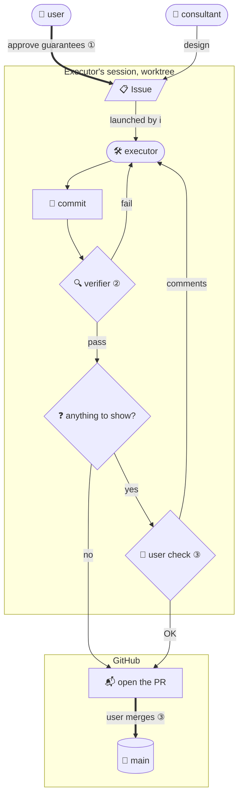

[🇯🇵 日本語](README.md) | [🇬🇧 English](README.en.md)

# AI-Agent Development Environment as Code

When developing with AI agents, the bottleneck moves from generating code to verification and conveying intent.
This repository publishes the personal development platform built on that premise, as code, together with its Nix configuration, the machinery that separates roles, and its skills. The rules to be followed are not left to documents but placed in the environment (Nix, Claude Code deny rules and hooks, skills).
Of the practices running here, the parts that carry over to team repositories are packaged as [sdlc-kit](https://github.com/yktsnet/sdlc-kit), and the parts that use the resulting artifacts and records for hiring, training, and evaluation as [mgmt-kit](https://github.com/yktsnet/mgmt-kit).

---

## Why

Now that AI writes the code, the time goes into **verification** and **conveying intent**. Agents go wrong without noticing, and left alone they carry destructive operations and secret leaks straight into production. Conditions missing from a request get filled in by inference and the agent still finishes something that runs, so the gap is easy to miss.

So this platform **does not assume a human who stays attentive**. The human decides "what must not break" and approves it; implementation and tests are left to the agents. When a promise is broken, a machine detects it and stops. The dividing line is **whether it can be written down and handed over**: for behavior, the agent runs the checks written in the Issue and confirms it itself; feel, which cannot be fully handed over in writing, is judged by a person who touches it.

---

## Principles

The machinery rests on three principles.

1. **Write the promises down first**
2. **Let mechanisms and separate contexts do the checking**
3. **Leave humans only the judgments that cannot be written down**

The order has dependencies. Without written promises, the mechanisms do not know what to enforce, and a separate context does not know what to check against. Without mechanisms that check, matching and watching creep back into the judgments meant to be left to humans.

The diagram below shows how one Issue reaches main. The consultant, executor, and verifier are roles that each run in a separate context (Design 2). Circled numbers mark the principle behind each step, and thick arrows are the user's actions.

The user checks feel, real-machine behavior, and drift from the agreement made when the Issue was filed; when there is nothing to show, the executor goes straight on to the PR (Design 3).

Hand-offs between roles are gathered into a single zsh function, `i`, which takes care of everything from launching an executor per worktree to merging and cleanup ([docs/issue-workflow.md](docs/issue-workflow.md)).

---

## Design

### 1. Write the Promises Down First

Whatever a human decides is written down and handed over before anything is built.

At the center is **Guarantee-Driven Development (GDD)**. A human approves what must not break (the guarantees) in the Issue's guarantee section, and the agent writes the tests that pin it down along with the implementation. If TDD is the discipline of writing tests first, GDD is the discipline of approving the promises first. Approved guarantees accumulate, together with the tests behind them, in each repository's guarantee ledger, `docs/guarantees/`. Behavior not in the ledger is not a promise (guarantee-audit, [Zenn: Guarantee-Driven Development](https://zenn.dev/yktsnet/articles/202608-guarantee-driven-development)).

Development runs in two phases, **handing over the driving documents**. In the launch phase, before the direction is settled, PLAN.md (remaining work) and JUDGE.md (design decisions) drive the work (mvp-docs). Once the guarantee ledger goes into formal use, it takes over and the repository moves to the Issue-driven phase.

### 2. Let Mechanisms and Separate Contexts Do the Checking

Checking is not left to human attention.

**Mechanisms**: what must not be crossed (`rebuild` commands, edits to `flake.lock`, the secrets mapping) is stopped by deny rules and hooks. Each hook's rejection message states why it stopped and the correct route, because a rejected agent tries something else and what it tries comes from the message. Calling a subagent is built into the procedure too, not requested each time: before committing edited Japanese documents, the writer passes them to the proofreader (jp-proofreader). What each hook stops is described in [.claude/hooks/](.claude/hooks/).

**Separate contexts**: when the same model builds and checks, it cannot notice on its own that it has gone off course. The consultant designs the Issue (local-issue), the executor implements it (pr-workflow), and the verifier ([issue-verifier](.claude/agents/issue-verifier.md)) checks the work against the Issue alone. The verifier is never given the executor's explanation, because it would then read the work through the executor's intent and lose sight of where it drifts from the promise. The executor also writes the tests, and an expected value copied from the implementation's output passes along with the bug, so the verifier re-derives the expected values of the tests used as evidence from the Issue on its own.

**Routing**: checks are routed in this order: deterministic checks (hooks, scripts, CI), then a separate context (an LLM such as the verifier), then a human. An LLM's check can come out differently on the same input, so anything that can be checked deterministically is not handed to an LLM to read; a script or hook does it instead (`check-scope.sh` fails a mismatch between the diff and the Issue's `対象`, its target files). A separate context takes only what cannot be answered without reading, such as re-deriving expected values or judging whether the work has drifted from the promise.

### 3. Leave Humans Only the Judgments That Cannot Be Written Down

The user holds four things: approving the guarantee section, checking feel and real-machine behavior in the executor's session, deciding whether to accept anything that strays from the promise, and merging. The user is never asked to match behavior, and nothing is shown twice.

Feel is checked first. For changes that show up on a screen, the screen is handed over before the tests and the ledger are written. If feel changes the shape, tests written first are wasted.

Narrowing this down also keeps human judgment from thinning out. As speed goes up, people grasp less and approvals drift into formality. Having handed off behavior matching, what people look at is narrowed to what only they can judge, so that every approval still holds.

---

## Foundation

### One Toolchain on Every Machine

One flake manages the macOS and Linux development machines. When tools or versions differ between machines, agents stall on commands that are not found or fail at runtime.

| Configuration | OS | Role |
|---|---|---|
| `linux-desktop` | NixOS (disko / SSD) | Primary dev machine. Where consultant chat and `i` are launched |
| `macbook` | macOS (nix-darwin) | Shares the home-manager layer with the Linux machine |

OS differences are confined to `pkgs.stdenv.isDarwin` on the Nix side and the shims in `os.sh` on the shell side. When an agent tries to use `brew` or `npm -g`, `block-non-nix-install.sh` stops it and points to the Nix procedure (nix-tool-install).

### One Source for Every Session

The settings, hooks, and skills in `.claude/`, together with `home-manager/config/claude/common.md`, are the source of truth. `home-manager/modules/claude.nix` copies them into `~/.claude` on every rebuild, so the same rules apply whichever repository or machine Claude Code is opened on. `block-live-claude-config-edit.sh` rejects direct edits to `~/.claude` and returns the source path instead. Persistent memory is kept in git by `memory.nix` so every machine sees the same set.

### Secrets Stay Out of the Prose

Issues, PRs, and commit messages use `<PLACEHOLDER>` instead of IPs, ports, and real hostnames. The mapping between real values and placeholders lives in `secrets-agents/`, which agents are not allowed to read or write. The mapping is encrypted with sops (age) and distributed through git, so every machine decrypts it with its own key and masks the same values (sops-secrets).

---

## Skills

Procedures and criteria are owned by the skill that uses them. The full index and the criteria for what gets published are in [.claude/skills/README.md](.claude/skills/README.md). Subagent definitions live in [.claude/agents/](.claude/agents/), and hooks in [.claude/hooks/](.claude/hooks/).

---

## Tech Stack

| Layer | Technology | Reason |
|---|---|---|
| Configuration | Nix Flakes, home-manager | Builds every machine's tools and settings from one declaration |
| macOS | nix-darwin | Lets macOS share the home-manager layer with the Linux machine |
| Disk | disko | Brings even the partition layout into the Nix declaration |
| Secrets | sops-nix, age | Ships ciphertext through git and lets each machine decrypt with its own key; plaintext never travels between machines |
| Agent | Claude Code | Its `settings.json` deny rules and PreToolUse hooks let prohibitions live as mechanisms rather than documents |
| Review | crit | Gives the user and the agent one shared entry point for reviewing the executor's diff and local pages |
| Hand-off | zsh | Turns each role boundary, from creating a worktree to publishing, into one command |
| Sessions | tmux, tmux-claude-session-manager | Moves between parallel Claude Code sessions |

---

## Scope

Only the layers involved in developing with agents (Claude Code, memory, secrets, review, and tmux session management) are extracted from the working dotfiles. Headless servers, WSL, editor and desktop settings, and the like from the working side are not included. Unifying tools through Nix, distributing `~/.claude`, decrypting the mapping, and persistent memory are tied to the machine and cannot be enforced from a team repository, so they are kept here rather than in sdlc-kit.

The repository is not meant to be cloned and applied to your own machines, so no setup steps are given. The device configurations assume the actual hardware and keys, and the encrypted contents of `secrets/` are not included. CI's `nix flake check` confirms that the published configuration still evaluates.
