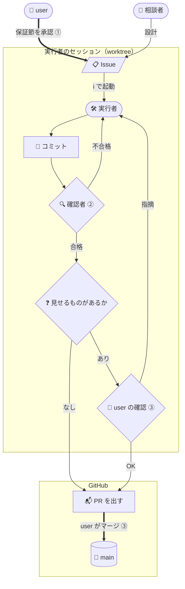

[🇯🇵 日本語](README.md) | [🇬🇧 English](README.en.md)

# AI-Agent Development Environment as Code

AI エージェントとの開発では、ボトルネックはコードの生成から、検証と意図伝達へ移る。
本リポジトリは、その前提で組んだ個人の開発基盤を、Nix 構成・役割分離の実行機構・skill 群ごとコードとして公開する実例である。守らせたい規則は文書に頼まず、環境（Nix・Claude Code の deny とフック・skill）に置いている。
ここで回している型のうち、チームのリポジトリへ持ち込める分を切り出したのが [sdlc-kit](https://github.com/yktsnet/sdlc-kit)、その型で揃った成果物と記録を採用・育成・評価に使う部分が [mgmt-kit](https://github.com/yktsnet/mgmt-kit) である。

---

## Why

AI がコードを書くようになって、時間がかかるのは**検証**と**意図伝達**になった。エージェントは気づかないうちに間違え、放っておけば破壊的な操作や機密の漏洩をそのまま本番へ通す。依頼に書かれていない条件は推論で埋めて動くものを仕上げるので、空白があったことに気づきにくい。

そのため、この基盤は**注意し続ける人間を前提にしない**。人間は「何が壊れてはいけないか」を決めて承認し、実装とテストはエージェントに任せる。約束が破られれば機械が検知して止まる。分かれ目は**書いて渡せるか**で、挙動は Issue に書いた確認をエージェントが自分で動かして確かめ、書いて渡しきれない使い心地は人が触って判断する。

---

## Principles

この基盤は3つの原則で組んでいる。

1. **守る約束を先に書く**
2. **確かめるのは仕組みと別の文脈**
3. **人には書けない判断だけを残す**

順序には依存がある。約束が書かれていないと、仕組みは何を守らせるかが、別の文脈は何を基準に確かめるかが決まらない。確かめる仕組みが無いと、人に残したはずの判断に照合と見張りが混ざる。

Issue 1件が main に入るまでの流れを図にすると次のようになる。相談者・実行者・確認者はそれぞれ別の文脈で動く役である（Design の2）。丸数字はその手順を支える原則の番号で、太い矢印は user の操作を表す。

user が確かめるのは使い心地・実機・起票時の合意から外れたことで、見せるものが無ければ実行者はそのまま PR を出す（Design の3）。

役割間の受け渡しは zsh の関数 `i` 1つにまとめてあり、`i` が worktree ごとの実行者の起動から、マージと後片付けまでを受け持つ（[docs/issue-workflow.md](docs/issue-workflow.md)）。

---

## Design

### 1. 守る約束を先に書く

人が決めることは作る前に書いて渡す。

中心は**保証駆動開発**（Guarantee-Driven Development, GDD）である。何が壊れてはいけないか（保証）を人が Issue の保証節で承認し、それを固定するテストと実装はエージェントが書く。TDD がテストを先に書く規律なら、GDD は約束の承認を先に行う規律である。承認した保証は各リポの保証台帳 `docs/guarantees/` に、裏付けるテストと一緒に積み上がる。台帳に載っていない振る舞いは約束ではない（guarantee-audit、[Zenn: 保証駆動開発](https://zenn.dev/yktsnet/articles/202608-guarantee-driven-development)）。各リポの台帳と約束の規模は [保証台帳の一覧](docs/guarantees-showcase.md) にまとめてある。

開発は2つのフェーズで**駆動文書を交代させる**。方向が固まらない立ち上げ期は PLAN.md（残作業）と JUDGE.md（設計判断）が開発を駆動し（mvp-docs）、保証台帳が正式運用に上がった時点で台帳へ交代して Issue 駆動期に入る。

### 2. 確かめるのは仕組みと別の文脈

確かめることを人の注意に預けない。

**仕組み**：外れてはいけないもの（`rebuild` 系、`flake.lock` の編集、機密の対応表）は deny とフックで止める。フックの拒否文には、止めた理由と正しい経路を書く。エージェントは拒否されると別の手を試し、何を試すかは拒否文で決まるからである。subagent を呼ぶこともその都度頼まずに手順へ組み込み、書き換えた日本語の文書はコミットの前に校正役（jp-proofreader）へ通す。各フックが何を止めるかは [.claude/hooks/](.claude/hooks/) にある。

**別の文脈**：同じモデルが作って確かめると、外したことに自分では気づけない。相談者が Issue を設計し（local-issue）、実行者が実装し（pr-workflow）、確認者（[issue-verifier](.claude/agents/issue-verifier.md)）が Issue だけを基準に確かめる。確認者に実行者の説明を渡さないのは、渡すと実行者の意図を前提に読み、約束から外れたところが見えなくなるからである。テストも実行者が書き、実装の出力を写した期待値は誤りごと通るので、確認者は証拠にしたテストの期待値を Issue から自分で出し直す。

**振り分け**：確かめる手段は、決定的な検査（フック・スクリプト・CI）、別の文脈（確認者などの LLM）、人の順に振り分ける。LLM の確認は同じ入力でも判定が変わることがあるので、決定的に確かめられるものは LLM に読ませず、スクリプトやフックに実装させる（差分と Issue の `対象` の一致は `check-scope.sh` が検査する）。別の文脈が受け持つのは、期待値の出し直しや約束から外れていないかのように、読まないと答えられないものだけにする。

### 3. 人には書けない判断だけを残す

user が持つのは4つである。保証節の承認、実行者のセッションでの使い心地と実機の確認、約束から外れたことを採るかの判断、マージ。挙動の照合は頼まず、同じものを二重に見せない。

使い心地は先に見る。画面に出る変更は、テストと台帳を書く前に画面を渡す。使い心地で形が変わると、先に書いたテストが無駄になる。

絞るのは人の判断を薄めないためでもある。速度が上がるほど人の把握は減り、承認は形だけになりやすい。挙動の照合を手放した分、人が見るものを本人にしか判断できないものへ絞り、一つ一つの承認が成り立つようにする。

---

## Foundation

### 全端末で道具を揃える

macOS と Linux の開発機を1つの Flake で管理する。端末ごとに道具の有無や版が違うと、エージェントはコマンドが見つからない、実行時に失敗する、といった形で止まる。

| 構成 | OS | 役割 |
|---|---|---|
| `linux-desktop` | NixOS（disko / SSD） | 主開発機。相談者チャットと `i` の起動元 |
| `macbook` | macOS（nix-darwin） | home-manager 層を Linux 機と共有する |

OS の差は Nix 側の `pkgs.stdenv.isDarwin` とシェル側の `os.sh` のシムに閉じ込める。エージェントが `brew` や `npm -g` を使おうとすると `block-non-nix-install.sh` が止め、Nix で入れる手順（nix-tool-install）へ案内する。

### 規則を1か所から全セッションへ配る

`.claude/` の settings・hooks・skills と `home-manager/config/claude/common.md` が正本で、`home-manager/modules/claude.nix` が rebuild のたびに `~/.claude` へ実体コピーするので、どのリポジトリ、どの端末で Claude Code を開いても同じ規則が適用される。`~/.claude` を直接編集しようとすると `block-live-claude-config-edit.sh` が止め、正本のパスを返す。永続メモリは `memory.nix` で git に載せ、端末間で揃える。

### 機密を地の文に出さない

Issue・PR・コミットの地の文には、IP・ポート・実ホスト名を書かずに `<PLACEHOLDER>` を使う。実値とプレースホルダの対応表は `secrets-agents/` に置き、エージェントからは読み書きさせない。対応表は sops（age）で暗号化して git で配り、どの端末でも自分の鍵で復号して同じものを伏せられるようにする（sops-secrets）。

---

## Skills

手順と基準は、それを使う skill が持つ。全体の一覧と、何を公開するかの基準は [.claude/skills/README.md](.claude/skills/README.md) にある。subagent の定義は [.claude/agents/](.claude/agents/)、フックは [.claude/hooks/](.claude/hooks/) にある。

---

## Tech Stack

| Layer | Technology | Reason |
|---|---|---|
| 構成管理 | Nix Flakes・home-manager | 全端末の道具と設定を1つの宣言から作れる |
| macOS | nix-darwin | macOS でも home-manager 層を Linux 機と共有できる |
| ディスク | disko | パーティション構成まで Nix の宣言に含められる |
| 機密 | sops-nix・age | 暗号文のまま git で配り、各端末が自分の鍵で復号できる。平文を端末間で運ばない |
| エージェント | Claude Code | `settings.json` の deny と PreToolUse フックで、禁止を文書ではなく機構として置ける |
| レビュー | crit | 実行者の差分とローカルのページを、user とエージェントが同じ入口からレビューできる |
| 受け渡し | zsh | worktree の作成から公開までを、役割の境目ごとに1コマンドにできる |
| セッション | tmux・tmux-claude-session-manager | 並行する Claude Code のセッションを渡り歩ける |

---

## Scope

稼働中の dotfiles から、エージェントとの開発に関わる層（Claude Code・メモリ・機密・レビュー・tmux のセッション管理）だけを抜き出している。稼働側にある headless のサーバー・WSL・エディタ・デスクトップの設定などは含めていない。Nix による道具の統一・`~/.claude` の配布・対応表の復号・永続メモリは端末に紐づき、チームのリポジトリからは配れないので、sdlc-kit には入れずここに残している。

clone して各自の端末へ適用することは想定しておらず、動かす手順も載せていない。デバイス構成は実機のハードウェアと鍵を前提にしていて、`secrets/` の暗号文も含めていないためである。CI の `nix flake check` は、公開している構成が評価できる状態にあることを確かめている。
